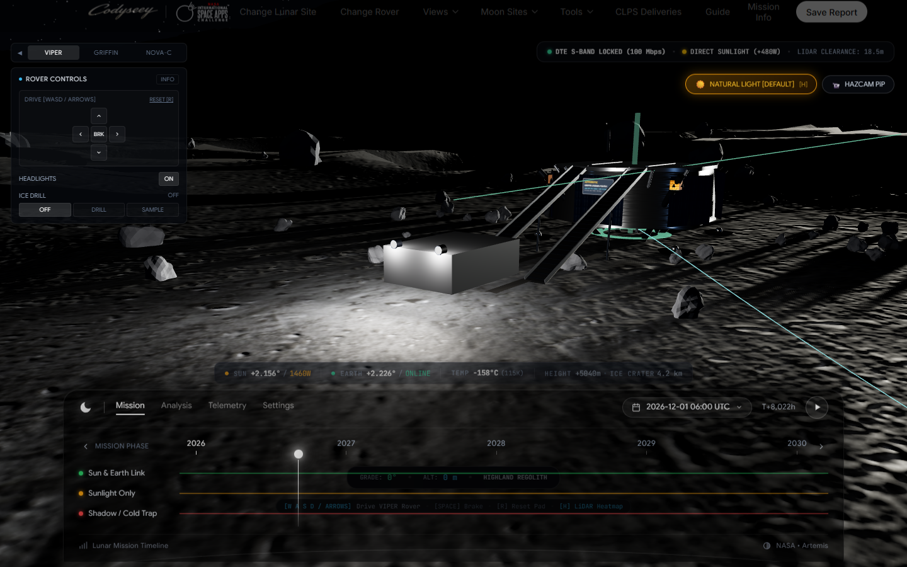
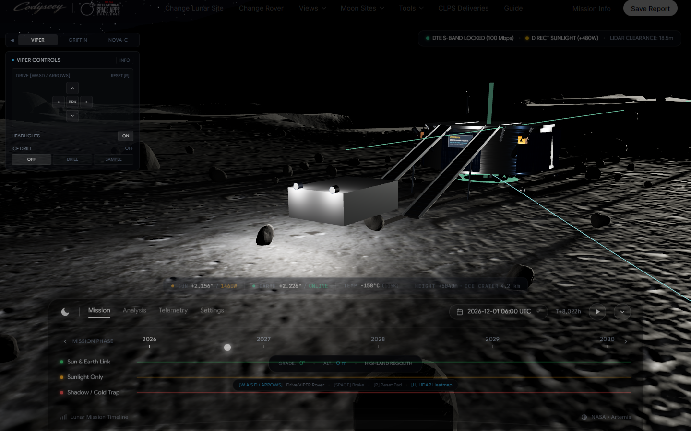
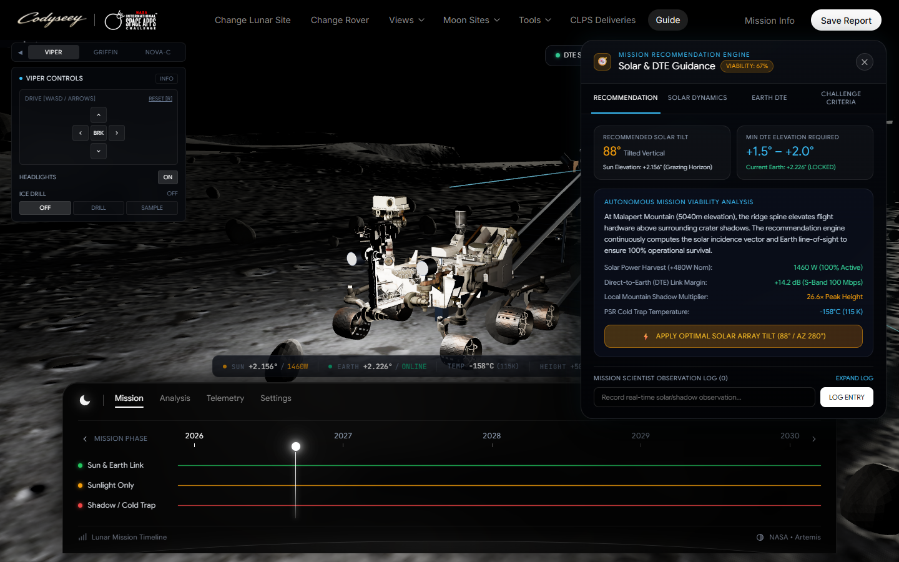
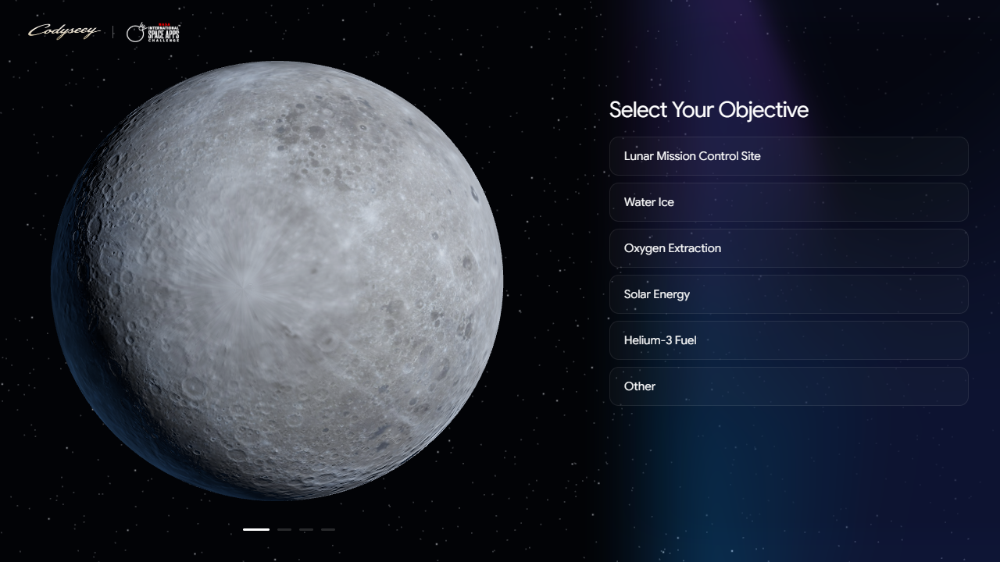
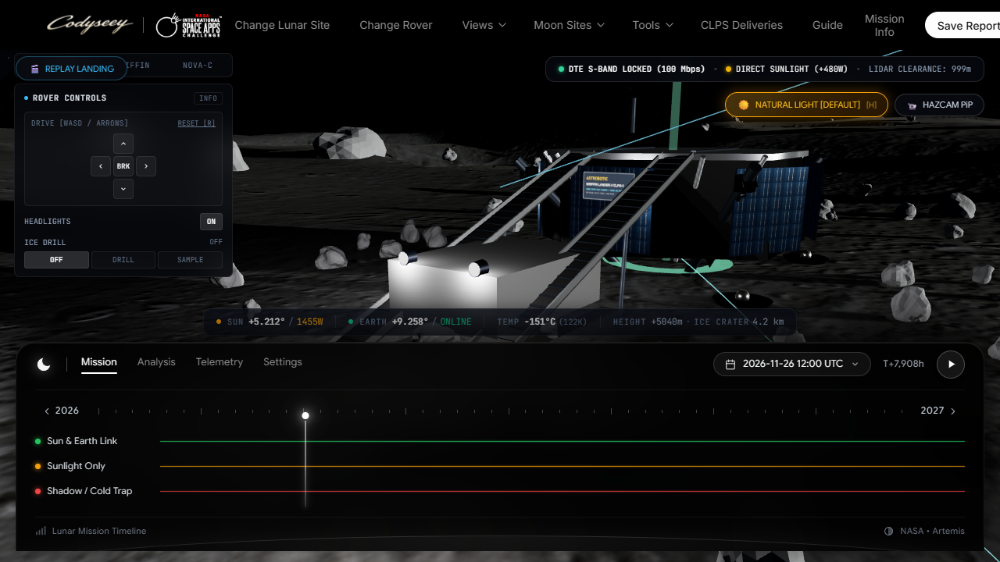

<div align="center">

# 🌕 CODYSEEY // CLPS Lunar Mission Browser
### Real-Time 3D Digital Twin & Mission Traversal Planner for the Lunar South Pole
**NASA International Space Apps Challenge 2026 — Challenge 4**

[](https://codyseeylunar.surge.sh)
[](https://www.spaceappschallenge.org/)
[](LICENSE)
[](https://react.dev/)
[](https://threejs.org/)
[](https://vitejs.dev/)

<br />

**[🚀 Launch Live 3D Simulation](https://codyseeylunar.surge.sh)** • **[📑 Technical Documentation](docs/README.md)** • **[📊 Official NASA Resources](docs/nasa-resources/)**

<br />



</div>

---

## 🌌 Executive Summary

The lunar South Pole is humanity's primary gateway for sustainable lunar presence under NASA's **Artemis** program and **Commercial Lunar Payload Services (CLPS)** deliveries. However, operations at the South Pole face three brutal physical constraints:

1. **Extreme Grazing Solar Angles (-1.5° to +1.5°):** Sun elevation angles barely skim the crater rims, casting dynamic shadows dozens of kilometers long that permanently freeze rover electronics within minutes.
2. **Dynamic 14-Day Earth Libration Eclipses:** Direct-to-Earth (DTE) communication visibility oscillates due to lunar libration cycles, periodically dropping high-gain communication links into total blackout.
3. **Severe Slopes & Boulder Hazards (>15°):** Ancient impact craters (Shackleton, Faustini, Haworth) possess steep walls exceeding the rollover threshold for wheeled rovers.

**CODYSEEY** is a zero-install, hardware-accelerated 3D lunar browser and mission simulator. It fuses sub-meter NASA LOLA topography and LROC optical maps with NASA JPL DE440/DE441 planetary ephemeris, giving mission architects, scientists, and students an interactive digital twin to explore, evaluate landing dates, and plan autonomous rover traversals from 2026 through 2030.

---

## 🕹️ Key Operational Capabilities

| Capability | Engineering Specification | Source Implementation |
| :--- | :--- | :--- |
| **Interactive 3D Moon Globe** | Real-time WebGL globe rendered with NASA LROC WAC mosaics, authentic lunar phase illumination, and smooth spherical damping camera controls. | [`src/components/Viewport3D.jsx`](src/components/Viewport3D.jsx) |
| **2026–2030 Solstice Ephemeris** | High-precision JPL DE441 astronomical ephemeris computing real-time sub-solar/sub-Earth coordinates, lunar libration, and solar flux across 5 years. | [`src/engine/ephemerisDE441.js`](src/engine/ephemerisDE441.js) |
| **Micro-Horizon Solar Ray-Tracing** | Computes ray-marched terrain horizons against elevation models, predicting exact shadow cast and watt-hours generated by 88.5° vertical arrays. | [`src/components/SolarShadowGuidanceCard.jsx`](src/components/SolarShadowGuidanceCard.jsx) |
| **Direct-to-Earth (DTE) Comms Engine** | Real-time RF link budget accounting for antenna gimbal azimuth/elevation, Earth elevation threshold (+1.8°), and crater rim occultation. | [`src/components/HorizonRadar.jsx`](src/components/HorizonRadar.jsx) |
| **11-Point 3D Ground Contact Physics** | Full terrain envelope collision model checking chassis clearance, multi-wheel contact, slope angles, and rock collision hazards. | [`src/components/Viewport3D.jsx`](src/components/Viewport3D.jsx) |
| **Upload Your Own Rover (UYOR)** | Universal drag-and-drop CAD import pipeline (.GLB / .GLTF) with automatic scale normalization, suspension binding, and solar capture analysis. | [`src/components/ScrollMissionShowcase.jsx`](src/components/ScrollMissionShowcase.jsx) |
| **Autonomous Shadow-Dodge Planner** | Heuristic pathfinding routing rovers between illuminated ridge waypoints while strictly respecting the 120-minute battery shadow budget. | [`src/utils/shadowDodgePlanner.js`](src/utils/shadowDodgePlanner.js) |
| **Automated Mission Brief Exporter** | One-click compilation of landing coordinates, solar window charts, and terrain safety matrices into executive PDF and PPTX decks. | [`src/utils/exportMissionBrief.js`](src/utils/exportMissionBrief.js) |

---

## 📸 Visual Showcase

<div align="center">
  <table>
    <tr>
      <td width="50%">
        
        <p align="center"><b>2026–2030 Solstice Timeline & Ephemeris Scrubber</b></p>
      </td>
      <td width="50%">
        
        <p align="center"><b>Multi-Tab Solar Dynamics & Earth DTE Link Budget</b></p>
      </td>
    </tr>
    <tr>
      <td width="50%">
        
        <p align="center"><b>Google Earth-Style Global Staging & Landing Site Reticles</b></p>
      </td>
      <td width="50%">
        
        <p align="center"><b>Astrobotic Griffin Lander & Powered Descent Simulation</b></p>
      </td>
    </tr>
  </table>
</div>

---

## 🗂️ Clean Project Architecture

```
clps-lunar-browser/
├── docs/                               # Project Documentation & Competition Archives
│   ├── nasa-resources/                 # Official NASA Challenge dossiers & research manifests
│   │   ├── challenge_04_CLPS_lunar_mission_browser.txt
│   │   ├── MASTER_RESOURCES_AND_TECH_MANIFEST.md
│   │   └── UI_UX_ARSENAL_AND_PREPARATION.md
│   ├── presentation/                   # Presentation pitch decks (.pptx) & generation scripts
│   └── screenshots/                    # High-resolution architectural screenshots
├── public/                             # Static Assets Served at Runtime
│   ├── draco/                          # Google Draco 3D mesh decompression WebAssembly loaders
│   ├── fonts/                          # Typography (Google Sans, Canela, Inter Display)
│   ├── models/                         # 3D assets (VIPER, Griffin, Nova-C, Apollo LM, Moon 3D)
│   ├── textures/                       # PBR regolith, LOLA elevation, and LROC color maps
│   └── videos/                         # High-definition lunar descent & loop videos
├── src/
│   ├── components/                     # Modular React UI components
│   │   ├── Viewport3D.jsx              # Master 3D WebGL engine & camera state machine
│   │   ├── TimeController.jsx          # 2026–2030 timeline scrubber & Solstice quick-jump
│   │   ├── SolarShadowGuidanceCard.jsx # 4-tab solar & comms guidance card
│   │   ├── HorizonRadar.jsx            # Micro-horizon 360° solar/Earth radar
│   │   ├── TelemetryHud.jsx            # Live avionics & rover power telemetry
│   │   └── ui/                         # Atomic micro-components (shiny-button, text-effect)
│   ├── engine/                         # Core Astrodynamics & Mathematical Engines
│   │   ├── ephemerisDE441.js           # JPL DE441 astronomical ephemeris calculations
│   │   ├── descentGuidanceHDA.js       # Hazard Detection & Avoidance terrain classifier
│   │   ├── orbitalScanner.js           # Orbital pass & remote sensing coverage model
│   │   └── comparativeMatrix.js        # Multi-site solar/comm ranking algorithms
│   ├── data/                           # Verified Lunar Datasets
│   │   ├── jplDE441_ephemeris_2026_2030.json # Precomputed high-resolution ephemeris tables
│   │   ├── landingSites.js             # Coordinates & physical parameters of CLPS sites
│   │   └── lunarCoreDrillAssays.js     # Simulated neutron spectrometer volatile assays
│   ├── utils/                          # 3D builders, shaders, device helpers, sound FX
│   │   ├── viperRoverBuilder.js        # 6-wheel rocker-bogie VIPER rover builder
│   │   ├── clpsLanderBuilder.js        # Griffin and Nova-C commercial lander builders
│   │   ├── terrainElevation.js         # LOLA elevation sampling & crater profiling
│   │   └── shadowDodgePlanner.js       # Volatile traverse pathfinder
│   ├── App.jsx                         # Global state coordinator & hardware device router
│   └── main.jsx                        # React 19 application entry point
├── tests/                              # Automated Integration & Playwright Test Suite
│   ├── verify_guide_and_timeline.cjs   # Verification for guidance tabs & solstice indicators
│   ├── verify_latest_features.cjs      # End-to-end mission staging verification
│   └── verify_all_user_fixes.cjs       # Ground contact and attitude clamping tests
├── package.json                        # Project dependencies & npm scripts
├── runner.cjs                          # Port-managed development runner
└── vite.config.js                      # Vite build configuration
```

---

## 📡 Official NASA Data Sources

In strict accordance with the NASA Space Apps Challenge criteria, all orbital mechanics, topography, and surface imagery are driven by official NASA planetary archives:

1. **NASA Lunar Reconnaissance Orbiter (LRO) LOLA Digital Elevation Models:**  
   High-resolution gridded topographic records (GDR) providing sub-meter elevation profiles across South Pole landing sites.  
   *Archive:* [NASA PDS Geosciences Node](https://pds-geosciences.wustl.edu/missions/lro/lola.htm)

2. **NASA LROC (Lunar Reconnaissance Orbiter Camera) Polar Imagery:**  
   Narrow Angle Camera (NAC) 0.5 m/pixel imagery and Wide Angle Camera (WAC) polar mosaics.  
   *Archive:* [LROC QuickMap & PDS Imaging Node](https://wms.lroc.asu.edu/lroc)

3. **NASA JPL Horizons / SPICE DE441 Ephemeris:**  
   High-precision solar, Earth, and lunar ephemerides defining sub-solar points, sub-Earth vectors, and lunar physical librations from 2026 to 2030.  
   *Archive:* [JPL Solar System Dynamics](https://ssd.jpl.nasa.gov/horizons/)

4. **NASA Moon Trek Planetary GIS:**  
   Standardized cartographic tile services and permanently shadowed region (PSR) maps.  
   *Archive:* [NASA JPL Solar System Treks](https://trek.nasa.gov/moon/)

5. **NASA Commercial Lunar Payload Services (CLPS) Manifests:**  
   Official task orders, lander dimensions, and payload manifests for Intuitive Machines (IM-1, IM-2), Astrobotic (Griffin Mission 1), and Firefly Aerospace.  
   *Archive:* [NASA CLPS Program](https://www.nasa.gov/commercial-lunar-payload-services/)

---

## 🛠️ Quickstart Guide

### Prerequisites
- **Node.js**: v18.0.0 or higher
- **Browser**: Modern Chromium, Firefox, or Safari with WebGL 2.0 support

### Installation
```bash
# Clone the repository
git clone https://github.com/ChinmaySonar/clps-lunar-browser.git

# Navigate into project directory
cd clps-lunar-browser

# Install dependencies
npm install
```

### Running Locally
```bash
# Start the local development server
npm run dev
```
Open **`http://localhost:5173`** in your browser.

### Building for Production
```bash
npm run build
```
Production assets are generated in `dist/` with WebAssembly Draco compression and optimized bundle chunking.

### Automated Testing & Linting
```bash
# Run oxlint fast linter
npm run lint

# Run automated verification tests
node tests/verify_guide_and_timeline.cjs
```

---

## 🏆 NASA Space Apps Challenge 2026

- **Challenge:** [Challenge 4: Commercial Lunar Payload Services (CLPS) Browser](https://www.spaceappschallenge.org/)
- **Live Production Deployment:** [https://codyseeylunar.surge.sh](https://codyseeylunar.surge.sh)
- **Award:** Finisher & Galactic Problem Solver Recognition

---

## 📄 License
This project is licensed under the **MIT License** — see the [LICENSE](LICENSE) file for details.
